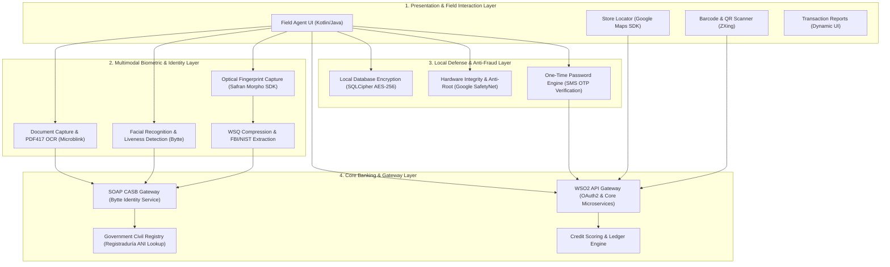

# Android Biometric Credit Origination & Field Banking Platform

[](https://www.android.com/)
[](https://kotlinlang.org/)
[](https://www.zetetic.net/sqlcipher/)
[](https://developer.android.com/training/safetynet)
[](https://www.idemia.com/)
[](https://www.registraduria.gov.co/)
[](#system-architecture)

Enterprise-grade native Android biometric customer onboarding, digital identity verification, credit origination, and retail point-of-sale utilization platform developed for **YoPresto** by **Trantec**. 

The platform enables financial correspondents, affiliated merchant stores, and field banking agents to onboard consumers in real time, authenticate their citizenship against the official Colombian civil registry (**Registraduría Nacional del Estado Civil - ANI**), execute multimodal biometric validation (facial liveness, OCR of citizenship documents, and FBI/NIST standard WSQ fingerprint verification), evaluate credit scoring, and disburse consumer loans with instant store purchase redemption.

---

## Architecture Overview

The system implements a hardened, multi-tier client architecture engineered to withstand device-level tampering while orchestrating low-latency biometric capture and government database lookups.



---

## Biometric Onboarding & Credit Disbursement Flow

The onboarding lifecycle enforces strict compliance with Colombian financial regulations and Habeas Data identity mandates:

```mermaid
sequenceDiagram
    autonumber
    actor Agent as Field Agent / Store
    actor Customer as Consumer
    participant App as Android Native App
    participant Bio as Biometric Engine (Bytte/Morpho)
    participant ANI as Civil Registry (ANI / Registraduría)
    participant Core as WSO2 Gateway & Core Banking

    Customer->>Agent: Request credit origination at affiliated store
    Agent->>App: Launch customer enrollment module
    App->>Bio: Scan Colombian Cédula (Front & Back PDF417)
    Bio-->>App: Extracted DNI payload (names, document number, birthdate)
    App->>Bio: Trigger facial recognition with liveness test
    Bio-->>App: Liveness verified and face template captured
    App->>Bio: Capture physical fingerprint on Safran Morpho reader
    Bio-->>App: WSQ fingerprint template generated
    App->>ANI: Transmit biometric package for official identity match
    ANI-->>App: ANI Verification: Identity confirmed (match score valid)
    App->>Core: Request algorithmic credit score and line allocation
    Core-->>App: Credit approved with pre-authorized balance
    Agent->>App: Input purchase items / transaction redemption amount
    App->>Core: Trigger OTP challenge via SMS to customer handset
    Customer->>Agent: Dictate dynamic OTP security code
    App->>Core: Authorize disbursement with OTP and digital signature
    Core-->>App: Transaction approved; credit ledger updated
    App-->>Customer: Digital receipt and transaction confirmation
```

---

## Key Engineering Highlights

### 1. Government Identity Verification (Registraduría ANI)
- Automated cross-check of consumer identity records against the Colombian civil identification archive (**Archivo Nacional de Identificación - ANI**).
- Implements SOAP CASB authentication services (`CASB_x002E_ProcesoAutenticacionService.java`, `ProcesoANIRequest.java`, `ANIResponse.java`).
- Prevents identity theft, synthetic identities, and deceased person identity spoofing in microfinance origination.

### 2. Multi-Sensor Biometric Integration
- **Document OCR:** Scans Colombian national identity cards (Cédula de Ciudadanía), extracting raw text, barcode metadata, and two-dimensional PDF417 optical codes via Microblink and Bytte OCR pipelines.
- **Facial Liveness Attestation:** Active liveness detection preventing photo presentation attacks and replay spoofs.
- **Hardware Fingerprint Scanners:** Direct driver integration with Safran Morpho biometric hardware (`AndroidBiometricSDK-4.7.0`, `lkms_core-1.2.5`) with WSQ (Wavelet Scalar Quantization) compression adhering to FBI/NIST image fidelity standards.

### 3. Local Data Security & Device Hardening
- **SQLCipher 256-bit AES Encryption:** Local persistent database is fully encrypted on disk (`net.zetetic:android-database-sqlcipher`), protecting cached customer payloads, offline queue events, and application secrets against physical memory dumps.
- **Google SafetyNet Attestation:** Real-time device integrity assessment (`play-services-safetynet`) that detects root cloaking, bootloader unlock states, and tampered system binaries prior to executing financial transactions.
- **Out-of-Band SMS OTP Signing:** Sensitive loan utilization requests require dynamic One-Time Password verification sent directly to the customer's registered telephone line.

### 4. Retail Point-of-Sale & Store Network Mapping
- **ZXing Barcode Integration:** High-speed barcode and QR scanning allows merchant agents to scan retail merchandise directly at the point of sale for instant line-of-credit financing.
- **Google Maps Geolocation:** Spatial indexing of registered partner stores, enabling consumers and field personnel to discover redemption points within their geographical vicinity.
- **WSO2 Enterprise Gateway:** Scalable OAuth2 token exchanges and API gateway proxying connecting Android clients to banking microservices hosted on Google Cloud Platform.

---

## Repository Structure

```
android-biometric-credit-origination-platform/
├── app/
│   ├── libs/                                   # Vendor biometric SDK binaries (.aar)
│   │   ├── AndroidBiometricSDK-4.7.0-biometry.aar # Safran Morpho fingerprint driver
│   │   ├── biometricbytte-3.0.8.aar           # Bytte face & biometric verification
│   │   ├── docbytte-3.0.6.aar                 # Bytte DNI optical document scanner
│   │   └── lkms_core-1.2.5.aar                # Morpho license key management
│   ├── src/
│   │   └── main/
│   │       ├── AndroidManifest.xml             # Permissions (Camera, GPS, Biometrics)
│   │       ├── java/com/trantec/yo/
│   │       │   ├── alerts/                    # Dialog & status notification controllers
│   │       │   ├── constants/                 # Endpoint configs, schemas, and keys
│   │       │   ├── dto/                       # Data Transfer Objects (ANI, OTP, Transactions)
│   │       │   ├── services/
│   │       │   │   └── bytte/authentication/  # Bytte CASB / ANI SOAP implementation
│   │       │   └── ui/                        # Core Android Activities & ViewModels
│   │       │       ├── Enrollment.kt          # Biometric customer enrollment flow
│   │       │       ├── Utilization.kt         # Credit redemption & retail purchase
│   │       │       ├── Stores.kt              # Google Maps merchant locator
│   │       │       ├── Reports.kt             # Ledger audit and sales reports
│   │       │       └── LoginActivity.kt       # Agent authentication & session setup
│   │       └── res/                           # Layouts, drawables, fonts, and strings
│   ├── build.gradle                            # App-level dependencies & NDK abiFilters
│   └── google-services.json.example            # Sanitized Firebase client template
├── ExKsoap2-1.0.2.5/                           # Custom SOAP XML serialization engine
├── ksoap2-android-assembly-3.6.2-.../          # KSoap2 Android communication runtime
├── gradle/wrapper/                             # Gradle build wrapper
├── build.gradle                                # Root build configuration
├── settings.gradle                             # Subproject orchestration
└── .gitignore                                  # Production Android ignore rules
```

---

## Technical Specifications

| Parameter | Specification |
| :--- | :--- |
| **Language** | Kotlin 1.2+ & Java 7/8 |
| **Minimum SDK** | Android API 18 (Android 4.3 Jelly Bean) |
| **Target / Compile SDK** | Android API 28 (Android 9.0 Pie) |
| **NDK Architectures** | `armeabi-v7a` (hardware biometric scanner driver compatibility) |
| **Database Engine** | SQLite with 256-bit AES SQLCipher encryption |
| **Biometric Standards** | WSQ (NIST/FBI), ISO/IEC 19794-2 (Minutiae), ISO/IEC 19794-4 |
| **Civil Identity Provider** | Registraduría Nacional del Estado Civil (ANI Colombia via Bytte CASB) |
| **Device Attestation** | Google Play Services SafetyNet Attestation API |
| **API Architecture** | WSO2 API Gateway (OAuth 2.0) + SOAP 1.1/1.2 XML Services |
| **Geolocation** | Google Play Services Maps SDK |
| **Optical Scanning** | ZXing Embedded & Microblink Mobile Scanner |

---

## Security & Sanitization Notice

This repository has undergone an automated security audit and git history rewrite using `git-filter-repo`:
- All development `.apk` and `.aab` compilation artifacts have been permanently stripped from commit history.
- Production keystore files (`*.jks`) and Android signing certificates were removed.
- Google Maps and Firebase API keys (`AIzaSy...`) were scrubbed and replaced with environment placeholders.
- Authorization bearer tokens and internal passwords were replaced with secure mock descriptors.

To configure local development credentials:
1. Copy `app/google-services.json.example` to `app/google-services.json` and insert your Firebase project credentials.
2. Supply your Google Maps API key in `app/src/main/res/values/google_maps_api.xml`.
3. Set your target API endpoint in `app/src/main/java/com/trantec/yo/constants/WebConstant.kt`.

---

## Build & Installation

### Prerequisites
- Android Studio 3.2+ or Android Studio Flamingo / Hedgehog with Android SDK Platform 28.
- Android NDK installed for ARMv7 native biometric driver compilation.
- Physical Android device with USB debugging enabled (recommended for camera and USB OTG biometric reader support).

### Compilation
```bash
# Clone the sanitized repository
git clone git@github.com-personal:KevinAndrey96/android-biometric-credit-origination-platform.git
cd android-biometric-credit-origination-platform

# Assemble debug APK
./gradlew assembleDebug

# Install on connected device via adb
adb install -r app/build/outputs/apk/debug/app-debug.apk
```

---

## License & Credits

Developed by **Kevin Andrey Herrera Silva** for **Trantec** and the **YoPresto** microfinance network. All rights to third-party SDKs (**Bytte**, **Idemia / Safran Morpho**, **Microblink**) belong to their respective proprietary holders.
